

  

   

  
  
    
  

---

## `01` SOBRE MI

<table>
<tr><td width="57%" valign="top">

<h3>Hola, soy Victor.</h3>

Desarrollo software orientado a <strong>resolver necesidades reales</strong>. Me interesan la ingenieria de software, la tecnologia educativa, los sistemas web, los asistentes inteligentes y la integracion de tecnologias.

<ul>
<li><strong>Proyecto principal:</strong> SAVP TIS 3, plataforma institucional de gestion academica y orientacion vocacional.</li>
<li><strong>Otros proyectos destacados:</strong> NETFLIX y MI JARVIS.</li>
<li><strong>Identidad creativa:</strong> SINAPSIS.</li>
</ul>

<code>BUILD</code> &nbsp; <code>LEARN</code> &nbsp; <code>IMPROVE</code> &nbsp; <code>REPEAT</code>

</td><td width="43%" valign="middle">
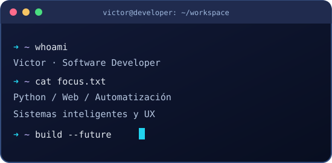
</td></tr>
</table>

## `02` STACK TECNOLOGICO

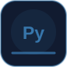
  
  
  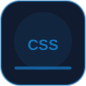
  
  
  
  
  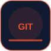
  
  
  
  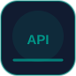
  
  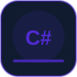
  
  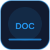
  

 Python · JavaScript · HTML · CSS · PHP · Laravel · PostgreSQL · MySQL · Git · GitHub · Linux · VS Code · FastAPI · Bootstrap · C# · Java · Docker · React

## `03` PROYECTOS PRINCIPALES

  <h3>01 - SAVP TIS 3 | Plataforma educativa</h3>
  <a href="https://github.com/Developer-vic1/savp-tis3">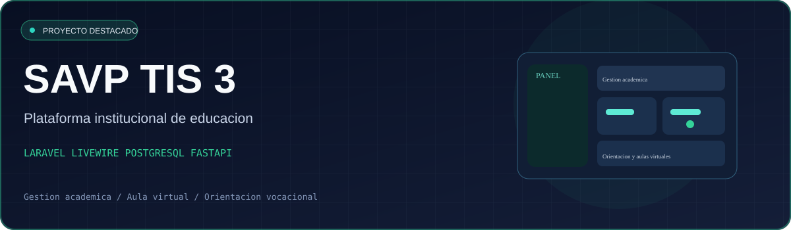</a>

**SAVP TIS 3** es mi proyecto educativo principal: integra gestion administrativa y academica institucional, aulas virtuales LMS y orientacion vocacional mediante evidencias. Usa **Laravel, Livewire, PostgreSQL** y un servicio de analisis en **Python/FastAPI**.

 Captura autentica del panel administrativo tomada del repositorio de SAVP TIS 3. No es una simulacion grafica.
 <a href="https://github.com/Developer-vic1/savp-tis3">Repositorio</a> · <a href="https://github.com/Developer-vic1/savp-tis3/blob/main/docs/sistema/01-MAPA-FUNCIONAL.md">Mapa funcional</a>

<table><tr>
<td width="50%" valign="top">
<a href="https://github.com/Developer-vic1/NETFLIX">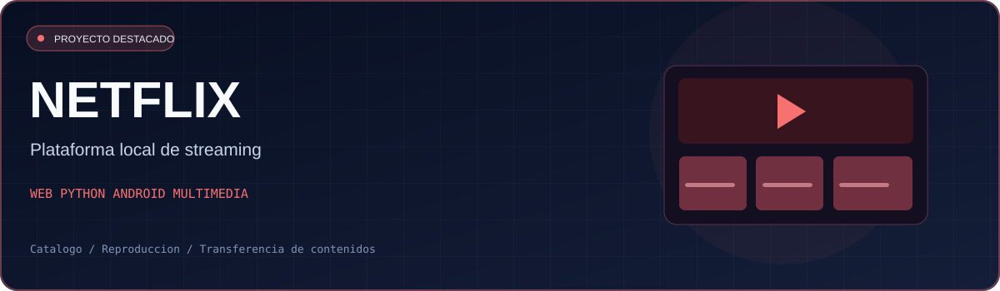</a>
<h3>02 - NETFLIX</h3>

Plataforma de streaming local con catalogo, reproduccion de episodios y peliculas, herramientas de administracion y una aplicacion Android para reproducir contenido transferido.

<a href="https://github.com/Developer-vic1/NETFLIX"><strong>Ver codigo y documentacion</strong></a>

</td>
<td width="50%" valign="top">
<a href="https://github.com/Developer-vic1/mi_jarvis">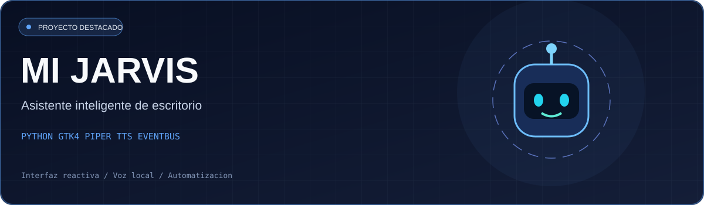</a>
<h3>03 - MI JARVIS</h3>

Asistente de escritorio Linux en Python, interfaz animada GTK4, sintesis de voz local Piper TTS y arquitectura orientada a eventos.

<a href="https://github.com/Developer-vic1/mi_jarvis"><strong>Ver codigo y documentacion</strong></a>

</td>
</tr></table>

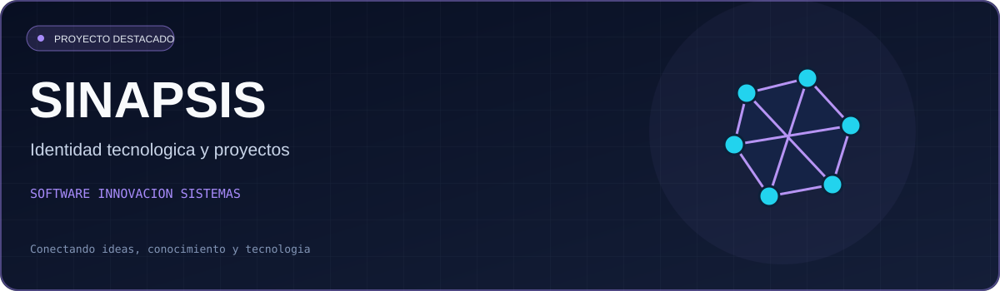

**04 - SINAPSIS:** mi identidad tecnologica y vision de desarrollo: conectar ideas, aprendizaje e innovacion para construir soluciones de software.

## `04` ESTADISTICAS REALES DE GITHUB

  
  

> Las estadisticas consultan un servicio externo y pueden demorarse o no mostrarse cuando hay limites de uso. No se han inventado cifras.

## `05` MOVIMIENTO Y CONTRIBUCIONES

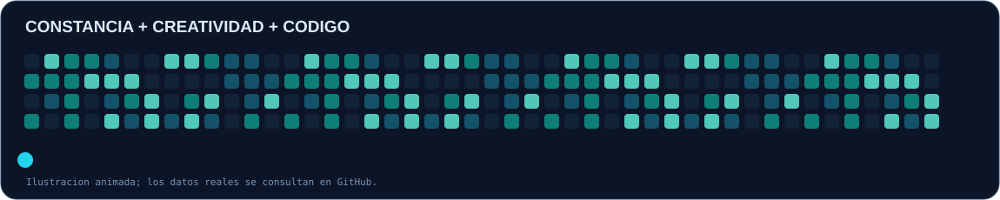

<!-- El workflow publica la serpiente real en la rama output. Tras su primera ejecucion aparecera esta animacion. -->

  

## `06` CONECTEMOS PROYECTOS

  <strong>Ideas que se convierten en sistemas. Aprender, construir, mejorar.</strong>
    
  
    
  

